# 🔥 Heat Exchanger ML Suite

End-to-end heat exchanger project: **physics + machine learning + fouling prediction + dashboards + API + SQL/BI + fin heat-transfer analysis**, all in one flat repository (no sub-folders).

> Merged from: `heat-exchanger-ml-project`, `-INDUSTRIAL`, `-DATA-SCIENCE-PRO`, `-MEGA-PACK`, `-SYLLABUS-PRO` and the Fin Heat Transfer Colab project.

---

## 🗺️ Architecture

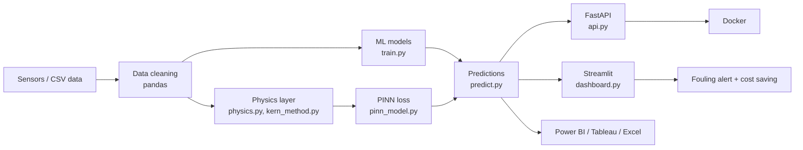

## 🔬 Heat exchanger physics

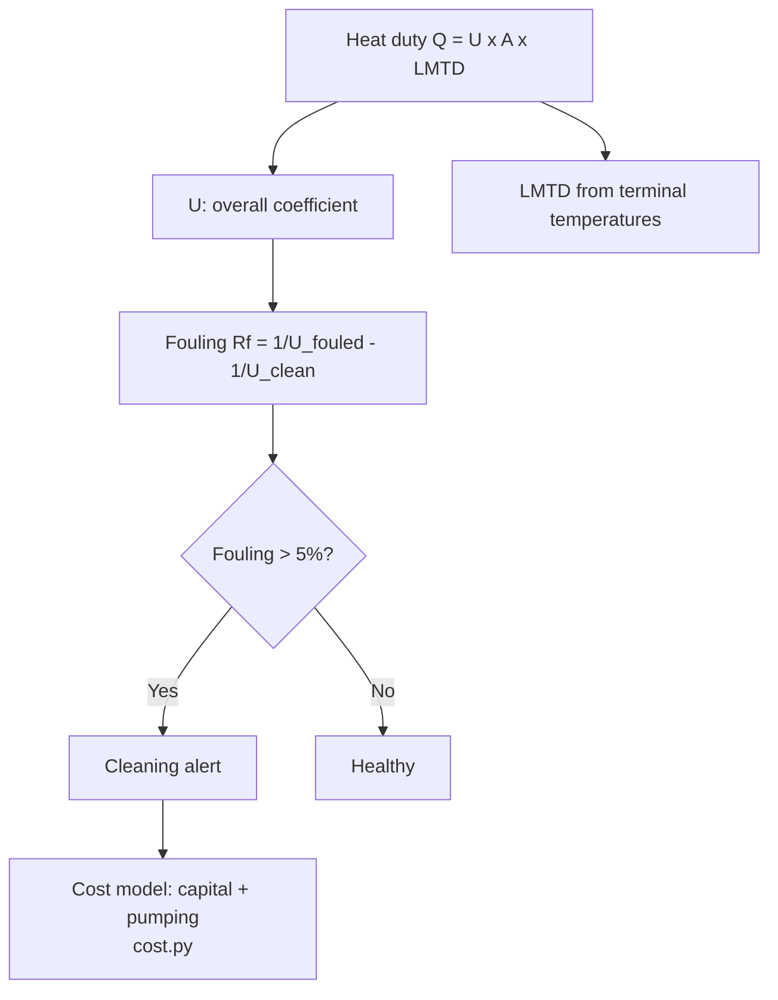

## 🤖 ML / data pipeline

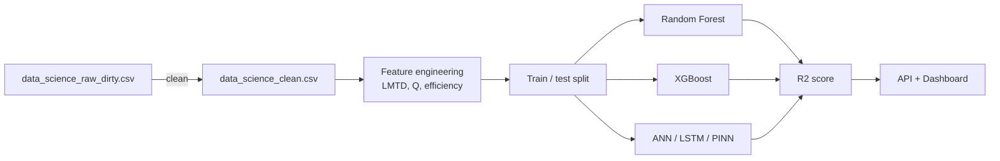

## 🧩 Fin heat-transfer notebook flow

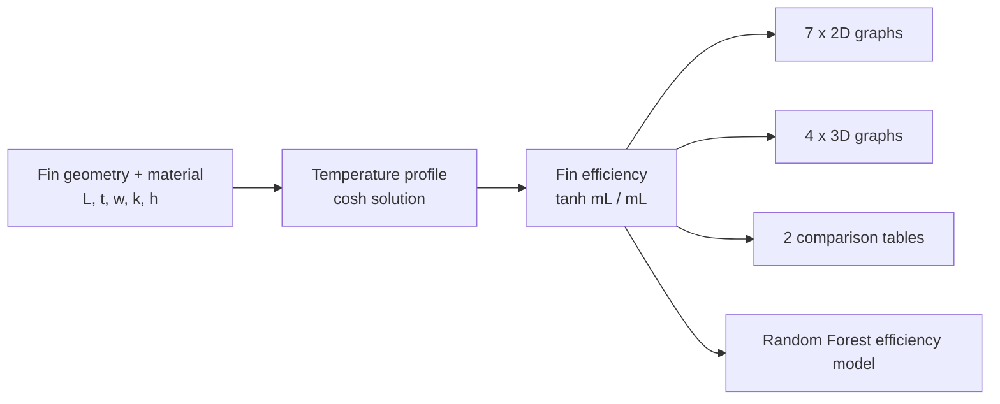

---

## 📁 File map (flat layout)

| Group | Files |
| :--- | :--- |
| Physics and design | `physics.py`, `kern_method.py`, `cost.py`, `pinn_model.py` |
| ML | `train.py`, `predict.py`, `notebook_heat_exchanger_ml.ipynb` |
| Fin analysis | `notebook_fin_heat_transfer_colab.ipynb` |
| Serving | `api.py` (FastAPI), `flask_app.py`, `dashboard.py` (Streamlit), `Dockerfile` |
| Data | `data_ml_heat_exchanger.csv`, `data_industrial_fouling.csv`, `data_monitoring_clean.csv`, `data_syllabus_clean.csv`, `data_science_clean.csv`, `data_science_raw_dirty.csv` |
| Stats | `stats_report.txt`, `stats_descriptive.csv` |
| SQL / NoSQL | `sql_database.sql` (15 queries), `mongodb_queries.js` |
| BI | `Excel_Dashboard.xlsx`, `powerbi_guide.md`, `dax_formulas.txt`, `tableau_guide.md` |
| MLOps | `etl_pipeline.py`, `deploy_aws_gcp_azure.md` |
| Interview / business | `interview_qa_50.md`, `interview_qa_syllabus.md`, `storytelling_business.md` |
| Tests | `test_physics.py` |
| Images | `img_*.png` |

## 🚀 Quick start

```bash
pip install -r requirements.txt

python train.py                 # trains Random Forest, saves model.joblib
python predict.py               # sample prediction of U
streamlit run dashboard.py      # live dashboard
uvicorn api:app --reload        # REST API (docs at /docs)
pytest                          # run tests
docker build -t hx-suite . && docker run -p 8000:8000 hx-suite
```

Fin analysis: upload `notebook_fin_heat_transfer_colab.ipynb` to Google Colab and use Runtime > Run all.

## 📐 Physics used

- Conduction: `Q = k·A·dT/dx`
- Convection: `Q = h·A·(Ts − Tf)`
- Radiation: `Q = ε·σ·A·(Ts⁴ − Tsurr⁴)`
- Heat exchanger: `Q = U·A·LMTD`
- Fouling resistance: `Rf = 1/U_fouled − 1/U_clean`
- PINN loss: `MSE_data + λ·MSE_physics`, physics term `Q − U·A·LMTD = 0`

## 🖼️ Diagrams

| | |
| :---: | :---: |
| 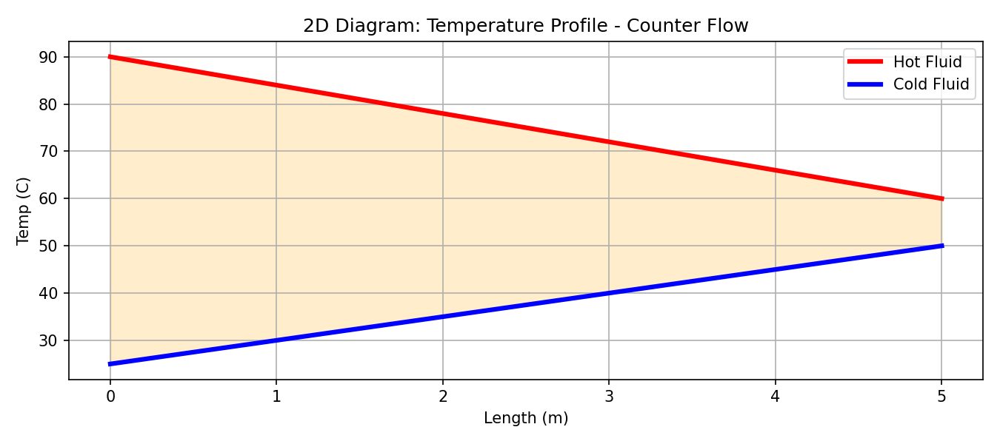 | 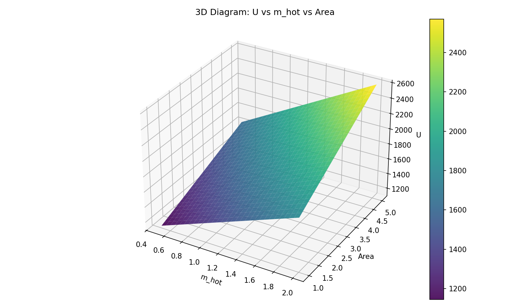 |
| 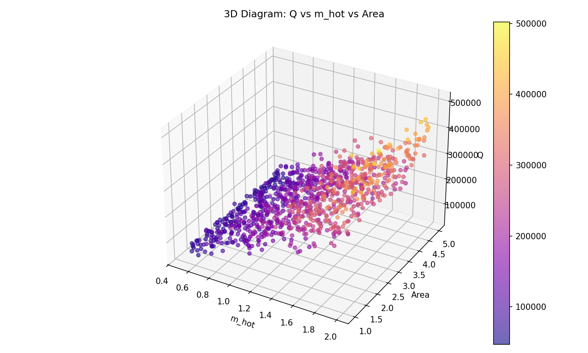 | 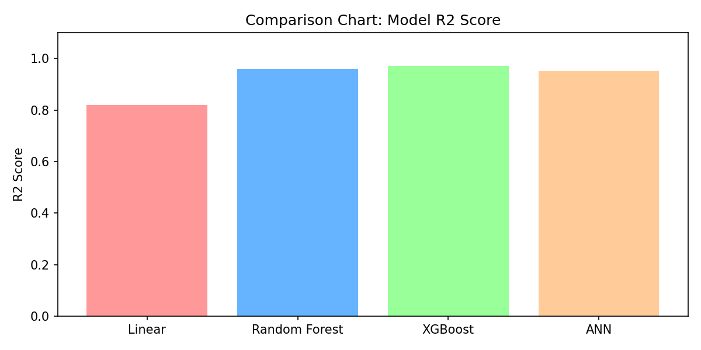 |
| 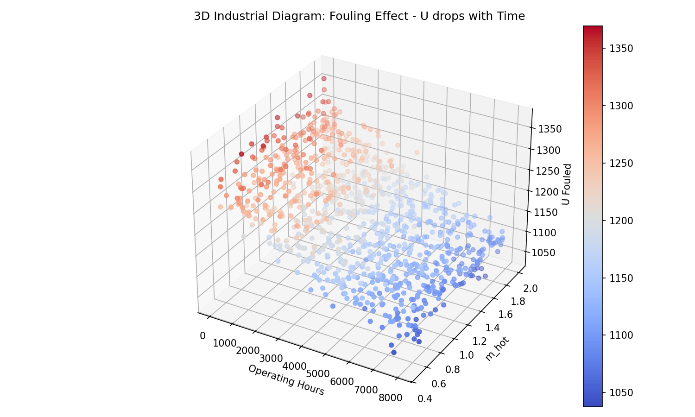 | 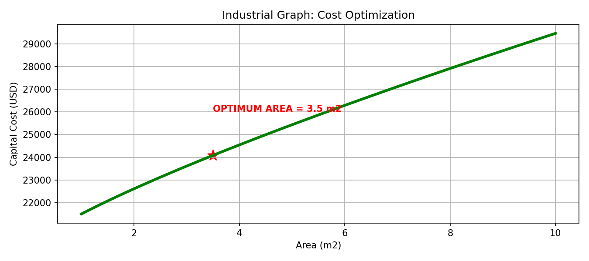 |
| 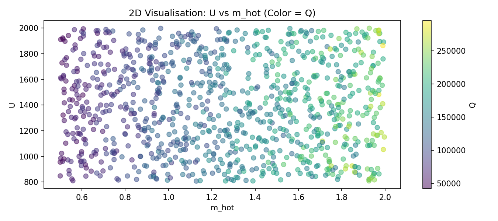 | 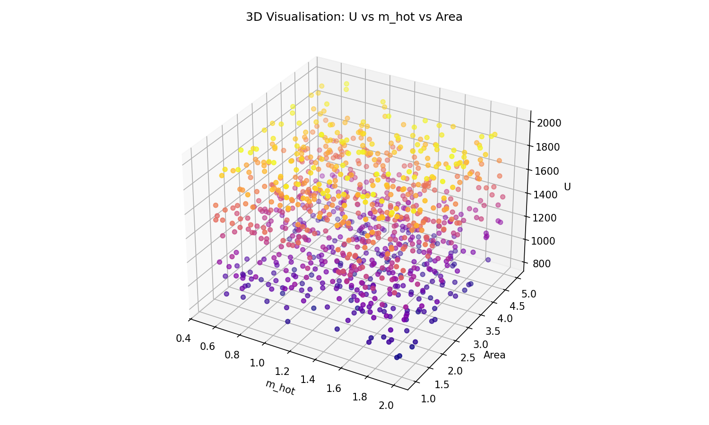 |
| 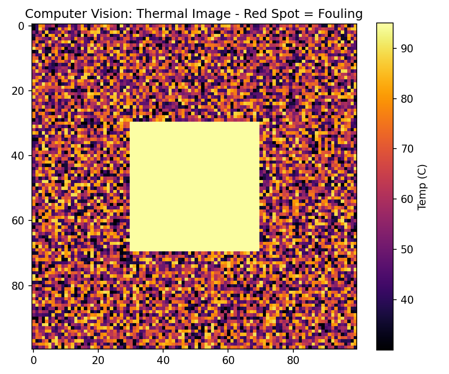 | 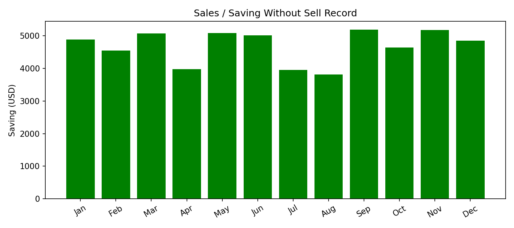 |
| 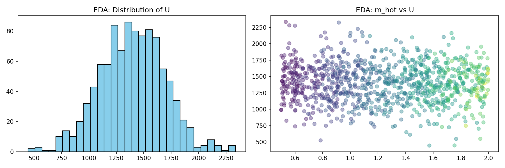 | |

## ⚠️ Notes

- Data is synthetic and for learning / portfolio use, not real plant data.
- `api.py` and `dashboard.py` use a simplified U formula for demo; real design uses `kern_method.py` / the trained model.
- Run `python train.py` to see the actual R² on your machine.

## 📜 License

MIT
